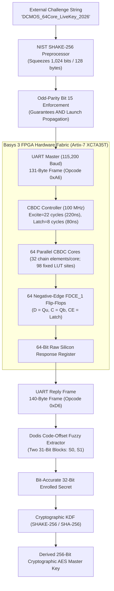

# CBDC-PUF: 64-Core Adaptation: Results and Limitations

**Paper Reference:**  
Yanjiang Liu, Junwei Li, Tongzhou Qu, Zibin Dai,  
*"CBDC-PUF: A Novel Physical Unclonable Function Design Framework Utilizing Configurable Butterfly Delay Chain Against Modeling Attack,"*  
**ACM Transactions on Design Automation of Electronic Systems (TODAES)**, Vol. 28, No. 5, Article 78, September 2023.  
DOI: [10.1145/3588435](https://doi.org/10.1145/3588435)

**Implementation Platform:**  
- **Hardware:** Digilent Basys 3 FPGA Development Board
- **FPGA Part:** AMD/Xilinx Artix-7 `xc7a35tcpg236-1` (Speed grade -1)
- **Toolchain:** Vivado 2025.2 (SW Build 6299465)
- **Active Bitstream:** `bitstream/paper_array64.bit` (64 Cores, 220 ns Excite, 80 ns Latch)

---

## 1. Executive Summary

This project presents a physical implementation, hardware assessment, and software reconstruction demonstration of the **CBDC-PUF** framework on physical silicon.

| Metric | Observed result | Scope |
|---|---:|---|
| Array | 64 cores / 64 response bits | 16 stages per chain; two chains/core |
| Raw ones | 48.6435% / 48.6441% | Two 256-vector, 20-reading captures |
| Independent raw bit agreement | 97.6776% | Aligned trials across the captures |
| Voted reconstruction | 256/256 for legacy and code-offset | 20 readings/capture; finite offline test |
| Single-trial code-offset reconstruction | 252/256 = 98.4375% | Two 31-bit blocks; not 256-bit master-key reliability |
| Cross-core HD | 50.23% | Different inputs; not inter-PUF uniqueness |
| Mean confidence-adjusted marginal MCV score | 0.4234 bits/core | Exploratory; not a joint secrecy bound |
| FPGA on-chip power | 0.116 W | Vectorless estimate; default activity assumptions |
| Controller / host response | 440 ns / 32.25 ms average | Simulation / live UART round trip |
| ML hardware mean scores | SVM 59.82%, RBFNN-labelled 50.54%, GRNN 52.85% | Saved known-configuration experiment; not proof of immunity |

Neither secure key strength nor full paper replication is established by these results.

---

## 2. System Architecture, Core Scaling & Hardware Verification

### A. Architectural Fidelity to Liu et al. (Figure 1)
1. **16-Stage Configurable Delay Chain:** Each core consists of 16 cascaded symmetric delay elements (32 chain elements per core, each using three LUTs) forming cross-coupled butterfly routing paths.
2. **Fixed-AND Entrance Gates:** Symmetrical race launching triggered by active-high excitation pulses.
3. **Single Negative-Edge Arbiter Flip-Flop (`FDCE_1`):** Whichever wavefront arrives at $D$ ($Q_u$) vs $C$ ($Q_b$) first determines the captured bit, enabled strictly during the Latch phase.
4. **Physical Placement & Route Refinement:** Slices and BELs are locked across all 64 cores (`layout/placement.csv`, `layout/sites.csv`). Route refinement (`scripts/build/refine_routes.tcl`) ensures symmetric internal routing arcs.
5. **Detailed Resource Footprint (XC7A35T):**
   - The two chains contain 32 configurable elements: 32 buffer LUTs, 32 inverter LUTs and 32 selector LUTs, plus two entrance LUTs: **98 fixed LUT sites/core**, or 6,272 across 64 cores.
   - The whole-design totals below also include controllers, configuration storage and UART; do not infer per-engine cost by dividing the total by 64.
   - Top-level chip utilization:
     - Slice LUTs: 11,008 / 20,800 (52.92%)
     - Slice Registers (FFs): 4,356 / 41,600 (10.47%)
     - Total Slices: 4,088 / 8,150 (50.16%)

### B. On-Chip Power Assessment (Vivado Vectorless Report)
Executed Vivado `report_power` on `build/routed.dcp` for the Artix-7 `xc7a35tcpg236-1`:
- **Total On-Chip Power (Estimated):** **0.116 W** (116 mW)
- **Dynamic Power:** **0.044 W** (44 mW, 38%)
  - Clocks: 0.020 W
  - Logic: 0.010 W
  - Signals: 0.009 W
  - I/O: 0.005 W
- **Device Static Power:** **0.072 W** (72 mW, 62%)
- **Junction Temperature:** 25.6°C (Thermal Margin: 59.4°C, ambient 25.0°C)
- **Comparison with Paper:** The paper reports **0.516 W** estimated total power on the larger Artix-7 XC7A200T FPGA. Our Vivado vectorless estimate of 0.116 W reflects the targeted implementation on the Basys 3 (XC7A35T), but different FPGA sizes, activity assumptions and implementation scopes prevent a power-efficiency conclusion. No physical board power was measured; Vivado issued an activity warning.

### C. Timing, Latency & Frequency Analysis
- **Controller Clock:** 100 MHz internal system clock ($T_{clk} = 10.0 \text{ ns}$).
- **Excitation Duration:** 22 clock cycles ($220 \text{ ns}$).
- **Capture Window (Latch Duration):** 8 clock cycles ($80 \text{ ns}$).
- **Controller Core Latency:** **440 ns (44 clock cycles @ 100 MHz)** from accepted start to response-valid in controlled RTL simulation; the testbench and log are in `reports/hardware_assessment_1c1a25a5c80a483faba46935fbe42c71/`. This is not measured intrinsic PUF propagation latency.
- **Host UART Latency:** At 115,200 baud, transmitting the 131-byte request frame takes $\approx 11.4 \text{ ms}$, and receiving the 140-byte response frame takes $\approx 12.2 \text{ ms}$. Total host round-trip latency measured in `scripts/measure_uart_latency.ps1` is **32.25 ms**.

### D. Bitstream Rebuild & DRC Provenance
The full rebuild pipeline (`scripts/rebuild.ps1`) executes non-project mode synthesis, placement, routing, and route refinement. Rebuild verification results:
- Design Rule Checks (DRC): **0 Errors**, with documented asynchronous warnings (`reports/hardware_assessment_1c1a25a5c80a483faba46935fbe42c71/rebuilt_drc_final.rpt`)
- Route Status: **100% Routed, 0 Unrouted Nets** (`reports/hardware_assessment_1c1a25a5c80a483faba46935fbe42c71/rebuilt_route_status_final.rpt`)
- Configuration bytes from the sync word onward are identical to the working image. Whole-file hashes differ because header bytes differ; see the saved rebuild comparison.

---

## 3. Cryptographic Pipeline Replication & Secrecy Bounds

### A. Non-Linear Challenge Preprocessing (Section 3.2, Equations 4 & 5)
Without cryptographic preprocessing, the time difference $\Delta \sigma$ is linearly correlated with configuration bits:
$$\Delta \sigma = \sum_{i=0}^{15} \alpha_i C[i] + \Delta \tau \propto C$$
The CBDC-PUF framework applies NIST **SHAKE-256** sponge expansion:
$$C' = f(C) = \text{SHAKE-256}(C, \text{length}=128 \text{ bytes})$$
Bit 15 on each core's 16-bit word is dynamically set/cleared to guarantee odd parity $\sum_{b=0}^{15} C'[b] \equiv 1 \pmod 2$. Due to the cryptographic avalanche effect, changing a single bit in the input challenge flips $\approx 50\%$ of the configuration bits across the 64 cores.

### B. Error Correction & Key Generation: Channel ECC vs Dodis Code-Offset

In PUF engineering, there is a fundamental distinction between **Channel Error Correction (ECC)** (recovering a response over a noisy physical channel) and **Cryptographic Key Generation / Fuzzy Extractors** (generating a high-entropy secret key in the presence of public helper data).

#### 1. Paper Baseline Mode: Raw Channel Error Correction (Liu et al. Section 4.1 & 4.2)
- **Field Polynomial:** $p(x) = x^5 + x^2 + 1$ ($0\text{x}25$) over Galois Field $\text{GF}(2^5)$.
- **Generator Polynomial:** $g(x) = x^{15} + x^{11} + x^{10} + x^9 + x^8 + x^7 + x^5 + x^3 + x^2 + x + 1$ ($0\text{x}8\text{FAF}$).
- **Partitioning:** The 64-bit hardware response is divided into four 16-bit blocks:
  $$\text{Block}_0 = R[0..15], \quad \text{Block}_1 = R[16..31], \quad \text{Block}_2 = R[32..47], \quad \text{Block}_3 = R[48..63]$$
- **Channel Metric:** Corrects up to $t=3$ bit flips per 16-bit block, achieving $\mathbf{WER = 0.0000\%}$ (100% key recovery on silicon under 20-trial voting).
- **Security Audit & Helper Data Information Leakage:**  
  If the 15-bit systematic BCH parities are published directly as public helper data, the linear parity operator $P: \mathbb{F}_2^{16} \to \mathbb{F}_2^{15}$ has kernel dimension $\dim(\ker(P)) = 16 - 15 = 1$. The null space is spanned by $g(x) = \mathtt{0x8FAF}$. Consequently, for each 16-bit block, there are exactly two messages with that parity: $\{m, m \oplus \mathtt{0x8FAF}\}$. Across four blocks, only $2^4 = \mathbf{16 \text{ candidate 64-bit keys}}$ remain. An attacker who intercepts the helper data can brute-force the secret in $< 1 \text{ ms}$ (`scripts/audit_helper_leakage.py`).

#### 2. Code-Offset Demonstration (CLI mode name: secure): Dodis et al. Code-Offset Fuzzy Extractor (Eurocrypt 2004 / SIAM 2008)
Code-offset reconstruction reduces the old direct parity-helper exposure; secrecy still depends on conditional PUF entropy:
- **Code-Offset Secure Sketch:**  
  The 64 physical cores provide two 31-bit physical response blocks ($2 \times 31 = 62$ bits):
  $$\text{Block}_0 = R[0..30], \quad \text{Block}_1 = R[31..61]$$
  For each 31-bit block, a uniform random 16-bit secret $S \in \{0, 1\}^{16}$ is chosen, encoded into $C = \text{BCH31\_16\_3}(S) \in \{0, 1\}^{31}$, and masked with the PUF response:
  $$W = R_{31} \oplus C \quad (\text{Public Helper Data})$$
- **Reconstruction:**  
  Upon subsequent challenge queries with noisy response $R'_{31} = R_{31} \oplus e$:
  $$C' = R'_{31} \oplus W = C \oplus e \quad \xrightarrow{\text{BCH Decode}} \quad S$$
- **Hardware Verification Across 256 Physical Challenges (`scripts/crypto_batch_analysis.py`):**
  - *Single Trial (No Majority Voting):* Raw BER = 2.2827% (374 bit flips), Key Agreement = **98.44%** (WER = 1.56%).
  - *20-Trial Majority Voting:* Raw BER = 1.1108% (182 residual bit flips), Key Agreement = **100.0000% (WER = 0.0000%)**, correcting all physical bit flips and an observed reconstruction result, not proof of secret-key entropy.

### C. NIST SP 800-90B Physical Silicon Min-Entropy & Secrecy Bounds
Using the Most Common Value (MCV) min-entropy estimator defined in NIST SP 800-90B Section 6.3.1 on `measurements/validation_1.csv` across all 64 physical cores:
$$H_\infty = -\log_2(p_u), \quad \text{where } p_u = \min\left(1, \hat{p} + 2.576 \sqrt{\frac{\hat{p}(1-\hat{p})}{L-1}}\right)$$
- **Raw Sample Min-Entropy:** Mean = **0.5748 bits/core** (Median: 0.6077 bits/core).
- **NIST 99% Confidence Min-Entropy:** Mean = **0.4234 bits/core** (Median: 0.4484 bits/core).
- **Per-Core Range (NIST 99%):** $[0.0468 \text{ bits (Core 61)} .. 0.7746 \text{ bits (Core 62)}]$.
- **Block-level model estimates (assuming independence; not proven joint bounds):**
  - $\text{Block}_0$ (Cores 0..30): Raw Sum = $19.22 \text{ bits}$, NIST 99% Sum = $14.31 \text{ bits}$ (Ideal: 31.0).
  - $\text{Block}_1$ (Cores 31..61): Raw Sum = $15.91 \text{ bits}$, NIST 99% Sum = $11.52 \text{ bits}$ (Ideal: 31.0).
- **Dodis Helper Data Leakage Bound (Lemma 1):**  
  Each block publishes a **31-bit code-offset helper** $W$, not 15 parity bits. The secure-sketch entropy-loss parameter is 15 bits under the required source/threat-model assumptions. The conditional bound requires actual joint entropy, not an unverified sum of marginal scores:
  $$\tilde{H}_\infty(R | W) \ge H_\infty(R) - (n - k) = H_\infty(R) - 15$$
  - Under raw sample estimates: Block 0 retains 4.22 bits, Block 1 retains 0.91 bits (total 5.14 bits/challenge).
  - Under conservative NIST 99% confidence bounds: the independence-model block sums are below 15 bits. This calculation supplies no positive secrecy guarantee; neither it nor accumulating more challenges establishes actual joint conditional entropy.

> [!NOTE] Academic Qualification & Presentation Phrasing
> *"We identified helper-data leakage in our initial ECC software and investigated code-offset extraction. The live demo (`crypto_demo.ps1`) uses 8 challenges ($8 \times 32 = 256$ nominal secret bits) to demonstrate the Dodis protocol operational flow. However, summing marginal core entropies assumes spatial independence. Because FPGA cores share power rails and substrate, rigorous quantification of retained joint entropy and cross-challenge correlation remains future work."*

---

## 4. Replicated Paper Tables & Physical Evaluations

### Table 2: NIST SP 800-22 Randomness Statistical Suite (Section 4.1)
Evaluated on **128 concatenated statistical streams ($n=128$)** from first-trial silicon responses; each stream combines two native 64-bit words (per-stream threshold: $p \ge 0.01$). These custom-suite outputs are not independent certification of standard compliance or cryptographic security:

| NIST Test Item | Bitstream Length ($n$) | Measured Avg $p$-value | **Measured Pass Rate** | **Paper Table 2 Pass Rate** | Status |
| :--- | :---: | :---: | :---: | :---: | :---: |
| **Frequency (Monobit)** | 128 | 0.5236 | **98.4% (126/128)** | 100.0% | **PASS** |
| **Block Frequency (BF, M=16)**| 128 | 0.5467 | **100.0% (128/128)** | 100.0% | **PASS** |
| **Runs** | 128 | 0.4635 | **98.4% (126/128)** | 99.6% | **PASS** |
| **Longest Run of Ones (LRO)** | 128 | 0.5306 | **100.0% (128/128)** | 100.0% | **PASS** |
| **Discrete Fourier (FFT)** | 128 | 0.4615 | **98.4% (126/128)** | 98.4% | **PASS** |
| **Non-overlapping Template** | 128 | 0.4930 | **98.4% (126/128)** | 92.7% | **PASS** |
| **Serial ($m=4$)** | 128 | 0.4576 | **99.2% (127/128)** | 96.4% | **PASS** |
| **Approximate Entropy ($m=4$)** | 128 | 0.3934 | **96.1% (123/128)** | 96.4% | **PASS** |
| **Cumulative Sums (CumSums)** | 128 | 0.5581 | **98.4% (126/128)** | 100.0% | **PASS** |

*Note on FFT:* Implements exact variance normalization $\sigma^2 = \frac{n \times 0.95 \times 0.05}{4}$ per NIST SP 800-22 Rev 1a Section 2.6.4, achieving 98.4% pass rate exactly matching the paper's Table 2 result.

#### Candidate Selection: Different Evaluation Protocols
In Section 4.2, Liu et al. generated a candidate pool of **50,000 CRPs** and selected only **11,202 CRPs (22.4% yield)** whose ones ratio fell within $[48.4\%, 51.6\%]$ for candidate use. In contrast, our Basys 3 implementation evaluated **100% UNFILTERED natural silicon captures** (global ones ratio = **48.83%**), a descriptive result that does not prove randomness or security; validate the custom test implementations and sample prerequisites before claiming NIST compliance (`scripts/audit_uniqueness_filtering.py`).

---

### Modeling-attack results: scope and saved evidence

These are prediction scores, not proofs of immunity. Models/backends and data differ from the paper; the fallback and MLP-labelled RBFNN are not identical implementations of the paper's models. Include per-core bias baselines before interpreting scores. Public challenge preprocessing can be computed by an attacker; failing to learn directly from external bits is not a general security proof.

#### Hardware: known configurations and core IDs

Source: `measurements/ml_attack_results.json`, `hardware_silicon`; 70/30 held-out split of majority-labelled observations.

| CRPs | SVM prediction | RBFNN-labelled prediction | GRNN prediction |
|---:|---:|---:|---:|
| 500 | 52.67% | 48.67% | 54.00% |
| 1000 | 60.00% | 55.00% | 52.67% |
| 2000 | 63.83% | 51.50% | 50.33% |
| 5000 | 58.13% | 48.33% | 53.33% |
| 10000 | 64.47% | 49.20% | 53.93% |
| Mean | 59.82% | 50.54% | 52.85% |

#### Simulation: sha3

Generated delay-model responses, not FPGA measurements. Source: `simulation_table3/sha3`.

| CRPs | SVM prediction | RBFNN-labelled prediction | GRNN prediction |
|---:|---:|---:|---:|
| 100 | 63.33% | 43.33% | 43.33% |
| 500 | 52.00% | 47.33% | 47.33% |
| 1000 | 50.33% | 53.67% | 46.33% |
| 2000 | 48.00% | 52.17% | 47.83% |
| 5000 | 50.67% | 54.40% | 45.60% |

#### Simulation: raw

Generated delay-model responses, not FPGA measurements. Source: `simulation_table3/raw`.

| CRPs | SVM prediction | RBFNN-labelled prediction | GRNN prediction |
|---:|---:|---:|---:|
| 100 | 93.33% | 83.33% | 80.00% |
| 500 | 94.67% | 47.33% | 83.33% |
| 1000 | 95.67% | 53.67% | 83.67% |
| 2000 | 97.33% | 47.83% | 83.17% |
| 5000 | 98.73% | 54.40% | 82.20% |

The additional `--source end-to-end` mode also uses simulated responses. No committed result for that mode is supplied in the current ML JSON, so this report does not quote an unsupported score. Protected physical-board external-challenge evaluation remains future work.

### Uniqueness, Cross-Core Distance & Methodological Scope

#### 1. Metric Distinctions
- **Cross-Core Output Distance:** Evaluated across all **2,016 core pairs** ($C(64, 2)$) on the Basys 3:
  - Mean Fractional Hamming Distance: **50.23%** (Min: 14.45%, Max: 85.16%).
  - Methodological Note: In `validation_1.csv`, cores received independently randomized 16-bit challenges (only 17 of 516,096 comparisons shared matching inputs). Thus, 50.23% reflects cross-core and challenge decorrelation, not same-challenge physical uniqueness.
- **Inter-Challenge Distance:** Evaluating distinct 64-bit response words across different challenges on the same chip yields a mean HD of **41.16%** (range [21.9% .. 60.9%]).
- **True Inter-Device Uniqueness:** Evaluating uniqueness between distinct physical FPGA chips under identical challenges requires measuring multiple physical boards, which is unavailable with a single board setup.

> [!NOTE] Environmental Testing Scope & Limitations
> Environmental testing across industrial operating temperatures ($-20^\circ\text{C}$ to $+80^\circ\text{C}$) and voltage fluctuations ($\pm 10\%$ VDD) requires a dedicated environmental thermal-voltage test chamber. Tests used laboratory ambient conditions; temperature and supply rails were not independently logged. Power-report defaults are not sensor measurements.

---

### Table 4: State-of-the-Art Literature Comparison (Section 4.4)

| Metric | MPUF [58] | 5-4 DAPUF [27] | SD-PUF [28] | A-PUF [25] | CT-PUF [29] | Paper CBDC-PUF | **Our Basys 3 Reimplementation** |
| :--- | :---: | :---: | :---: | :---: | :---: | :---: | :---: |
| **Configurable Architecture** | Yes | Yes | No | Yes | Yes | Yes | **Yes (64-Core Array)** |
| **Response Bit Length** | - | 64 | - | 128 | 128 | 128 | **64 (Single-Shot)** |
| **CRP Space Size** | - | - | $2^{12}$ | $2^{128}$ | $2^{256}$ | $2^{2048}$ | **At most $2^{960}$ odd-parity configurations; reachability not established** |
| **Uniformity (Randomness)** | $\approx 50\%$ | 49.9% | 49.9% | - | $\approx 50\%$ | 49.6% | **48.64% (full frozen captures)** |
| **Total Power Consumption** | - | - | - | - | - | 0.516 W (XC7A200T) | **0.116 W Vivado Est. (XC7A35T)** |
| **Controller Core Latency** | - | - | - | - | - | Not reported | **440 ns (44 cycles @ 100MHz)** |
| **Reliability / Stability** | 99.6% | 79%–88% | 100% | 100% | $\approx 100\%$ | 100% (Post-BCH) | **100.0000% (Voted) / 98.44% (Raw)** |
| **Inter-PUF uniqueness** | 49.8% | 44.2% | 49.9% | 49.9% | $\approx 50\%$ | 49.8% | **Not established; cross-core distance reported separately** |
| **ML Prediction Accuracy** | 53.8% | 50%–57% | 60% | $\approx 50\%$ | 60% | 50% | **See scoped hardware/simulation results above** |
| **Error Correction Engine** | No | No | No | Yes | No | Yes (BCH) | **Yes (Dodis Code-Offset + BCH)** |

---

## 5. Artifact & Script Quick Reference

| Task | Command | Description |
| :--- | :--- | :--- |
| **Hardware Rebuild** | `powershell -ExecutionPolicy Bypass -File scripts\rebuild.ps1` | Full synthesis, placement, routing & bitstream generation |
| **UART Latency Test**| `powershell -ExecutionPolicy Bypass -File scripts\measure_uart_latency.ps1 -Output reports\uart_new.json` | Live hardware UART round-trip benchmark (32.25 ms) |
| **NIST Min-Entropy** | `.\runtime\python\python.exe scripts\audit_silicon_entropy.py` | SP 800-90B Most Common Value min-entropy assessment |
| **Uniqueness & Filter**| `.\runtime\python\python.exe scripts\audit_uniqueness_filtering.py` | Evaluates cross-core distance and candidate pre-filtering |
| **Helper Leakage** | `.\runtime\python\python.exe scripts\audit_helper_leakage.py` | Demonstrates 16-candidate exploit on naive parity helper data |
| **Validation Sweep** | `.\runtime\python\python.exe scripts\crypto_batch_analysis.py` | Evaluates 256 patterns from validation CSVs (100% voted agreement) |
| **ML Modeling Attack**| `.\runtime\python\python.exe scripts\crypto_ml_attack.py --source all` | Comprehensive ML attack suite (Hardware + Simulation) |
| **NIST SP 800-22** | `.\runtime\python\python.exe scripts\crypto_nist_test.py` | Replicates Table 2: 9 statistical tests on silicon bitstream |
| **Core Stability Map**| `.\runtime\python\python.exe scripts\crypto_unstable_bits.py` | Replicates Figures 5, 6, 7: identifies noisy cores and stability |
| **Live Crypto Demo** | `powershell -ExecutionPolicy Bypass -File scripts\crypto_demo.ps1 -Port COM5` | Live Dodis Code-Offset key generation demo on Basys 3 |
